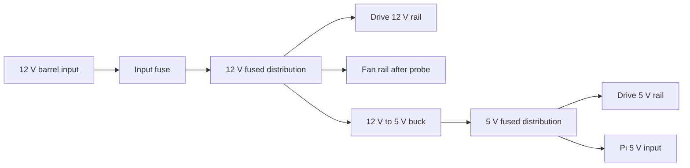

# Power and wiring

The NAS200 input is 12 V DC. The rebuild needs regulated 12 V for the drive
rails and confirmed fan, plus regulated 5 V for the drive rails, Raspberry Pi,
and any confirmed 5 V loads. SATA power is not 12 V only. The Pi must never
receive 12 V.

| Component | Minimum requirement | Required validation |
|---|---|---|
| Input fuse | DC-rated and sized from measured worst-case load | Protected fault test |
| 12 V distribution | Insulated branch per load group | No exposed conductor or excess voltage drop |
| Buck converter | Regulated 5 V, at least 5 A continuous | Holds output in specification at worst-case load |
| SATA harness | 5 V, 12 V, and ground to each drive | Measured rails at every connector |
| Pi lead | Fused, strain relieved, polarity keyed | Pi rail remains in its operating range |

Bench sequence: verify barrel polarity with no load, verify the buck alone,
load-test its 5 V output, boot the Pi, then add one drive and bridge at a time.
Measure input current and both rails during startup and sustained I/O. A
brownout, USB reset, filesystem error, or Pi undervoltage warning fails the
power path.
