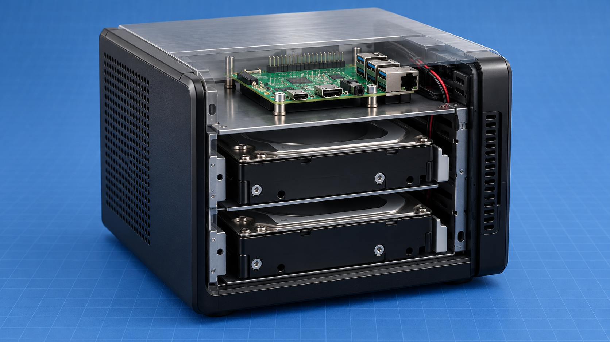

# nas200-reborn

Build a Raspberry Pi 3 storage server inside a Linksys NAS200 enclosure. The
guide preserves the upper and lower drive bays while replacing the original
controller, power distribution, and storage interface.

## Start here

1. Confirm the [hardware baseline](hardware.md) and source the [BOM](guide/bom.md).
2. Build and test the [power path](guide/power.md) before connecting storage.
3. Install the Pi with the [mechanical](guide/mechanical.md) and [GPIO](guide/gpio.md) requirements.
4. Configure [storage](guide/storage.md) and [software](guide/software.md).
5. Complete the [validation matrix](guide/validation.md).

- [Hardware baseline](hardware.md)
- [Software baseline](software.md)
- [Builder guide](guide/index.md)
- [References](references.md)

Verify enclosure-specific dimensions, panel pinouts, fan wiring, and rail
measurements before applying the corresponding build step.
